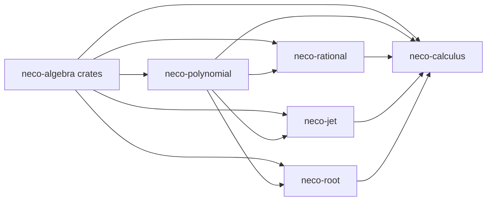

# neco-calculus

[English](README.md)

`neco-calculus` は、実代数的数の上で多項式の微積分を厳密に行うための Rust のクレート群です。正規形の多項式、有理関数、有限の微分列、根の検証をそれぞれのクレートで提供し、`neco-calculus` クレートが、それらを組み合わせた評価、微分列、根区間の縮小、区間上の符号の判定、候補点の根の分類、求積の操作を公開します。

根区間の縮小は、根を含む区間を二分法か Newton 二分法で狭める操作で、その過程を縮小の証拠として返します。区間上の符号の判定では、区間の上で多項式の符号が一定か、区間内で変わるかを調べます。候補点の根の分類は、呼び出し側が渡した候補点のうち多項式の根である点を、符号が変わる根と、符号を保つ根に分ける操作です。

超越関数の評価、曲面の検証付き評価 ( `evaluate_surface_checked` ) 、求積の結果は、来歴を保持しています。来歴の要素は、所有者の識別子、評価の要求、計算した実装の識別情報 ( 版と公開 API の識別子 ) の三つです。

評価の要求は、消費点 ( 結果を受け取る利用箇所 ) の識別子、式の識別子の列、判定の指定、要求精度を含みます。判定の指定は、消費点が求める厳密な判定の種類 ( 零、等値、符号、縮退 ) と、その判定で調べる式 ( 等値の判定では二つの式 ) を表します。判定で調べる式の識別子は、式の識別子の列に含まれます。

各操作が使う計算資源には上限があります。

## クレート構成

* [`neco-polynomial`](https://crates.io/crates/neco-polynomial): 正規形の厳密な多項式、形式微分、区間評価
* [`neco-rational`](https://crates.io/crates/neco-rational): 点と区間で定義域を検証する厳密な有理関数
* [`neco-jet`](https://crates.io/crates/neco-jet): 階数の上限を公開した、厳密な微分値の有限列
* [`neco-root`](https://crates.io/crates/neco-root): 検証済みの根区間、根区間の縮小と縮小の証拠、重複度、区間上の符号の判定、候補点の根の分類
* [`neco-calculus`](https://crates.io/crates/neco-calculus): 評価、微分列、根区間の縮小、区間上の符号の判定、候補点の根の分類、求積の公開操作

## 依存関係



**外部依存クレート**

* [`neco-algnum`](https://docs.rs/neco-algnum): 厳密な実代数的数と区間演算
* [`neco-bigint`](https://docs.rs/neco-bigint): 厳密な整数と二進有理数の演算
* [`neco-expr`](https://docs.rs/neco-expr): 結果の来歴に記録する識別子 ( 式グラフの節点を指す式の識別子など )
* [`neco-formsum`](https://docs.rs/neco-formsum) と [`neco-monomial`](https://docs.rs/neco-monomial): 二進有理数の点を実代数的数へ変換するための形式和と単項式

**本リポジトリを利用するリポジトリ**

* [`neco-geometry`](https://github.com/barineco/neco-geometry): 実代数的数を座標とする厳密な幾何計算

## 関連リンク

* [多項式の API 文書](https://docs.rs/neco-polynomial)
* [有理関数の API 文書](https://docs.rs/neco-rational)
* [微分列の API 文書](https://docs.rs/neco-jet)
* [根解析の API 文書](https://docs.rs/neco-root)
* [微積分の API 文書](https://docs.rs/neco-calculus)
* [ソースリポジトリ](https://github.com/barineco/neco-calculus)

## ランタイム構成

既定の構成では、依存関係にある全てのクレートが標準ライブラリを使います。

```toml
[dependencies]
neco-calculus = "0.2"
```

既定の `std` 機能を無効にすると、動的メモリ確保だけを前提に動作するため、標準ライブラリの無い環境でも使えます。公開する値、結果、失敗の意味は、どちらの構成でも同じです。

```toml
[dependencies]
neco-calculus = { version = "0.2", default-features = false }
```

全てのクレートで `unsafe` コードの使用を禁止しています。

## ライセンス

MIT License です。詳細は [LICENSE](LICENSE) を参照してください。
