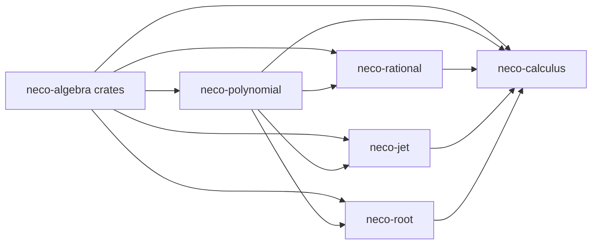

# neco-calculus

[English](README.md)

`neco-calculus` は、実代数的数を扱う厳密な多項式微積分の Rust クレート群です。正規多項式、有理関数、有限の微分列、検証済みの根解析、型付きの出自と有限な計算資源の上限を持つ微積分を提供します。

## クレート構成

本リポジトリは以下の 5 つのクレートで構成されています。

* [`neco-polynomial`](https://crates.io/crates/neco-polynomial): 正規化した厳密多項式、形式微分、区間評価
* [`neco-rational`](https://crates.io/crates/neco-rational): 点と区間の定義域を検証する厳密有理関数
* [`neco-jet`](https://crates.io/crates/neco-jet): 公開された階数上限を持つ有限の厳密微分列
* [`neco-root`](https://crates.io/crates/neco-root): 検証済みの根区間、細分化の検証結果、重複度、局所的な所属解析
* [`neco-calculus`](https://crates.io/crates/neco-calculus): 観測可能な出自を持つ厳密評価と細分化の操作

## 依存関係



**外部依存クレート**

* [`neco-algnum`](https://docs.rs/neco-algnum): 厳密な実代数的数と区間演算
* [`neco-bigint`](https://docs.rs/neco-bigint): 厳密な整数と二進有理数の演算
* [`neco-expr`](https://docs.rs/neco-expr): 検証済み評価が利用する安定した式の識別子
* [`neco-formsum`](https://docs.rs/neco-formsum) と [`neco-monomial`](https://docs.rs/neco-monomial): 根の検証結果が利用する代数形式

**本リポジトリを利用するリポジトリ**

* [`neco-geometry`](https://github.com/barineco/neco-geometry): 厳密な代数幾何計算

## 関連リンク

* [多項式の API 文書](https://docs.rs/neco-polynomial)
* [有理関数の API 文書](https://docs.rs/neco-rational)
* [微分列の API 文書](https://docs.rs/neco-jet)
* [根解析の API 文書](https://docs.rs/neco-root)
* [微積分の API 文書](https://docs.rs/neco-calculus)
* [ソースリポジトリ](https://github.com/barineco/neco-calculus)

## ランタイム構成

既定では、依存関係全体で標準ライブラリと連携します。

```toml
[dependencies]
neco-calculus = "0.1"
```

標準ライブラリのない環境では、動的メモリ確保だけを使います。公開値、結果、失敗の意味は同じです。

```toml
[dependencies]
neco-calculus = { version = "0.1", default-features = false }
```

全てのクレートで unsafe code を禁止しています。

## ライセンス

MIT License (詳細は [LICENSE](LICENSE) を参照)
