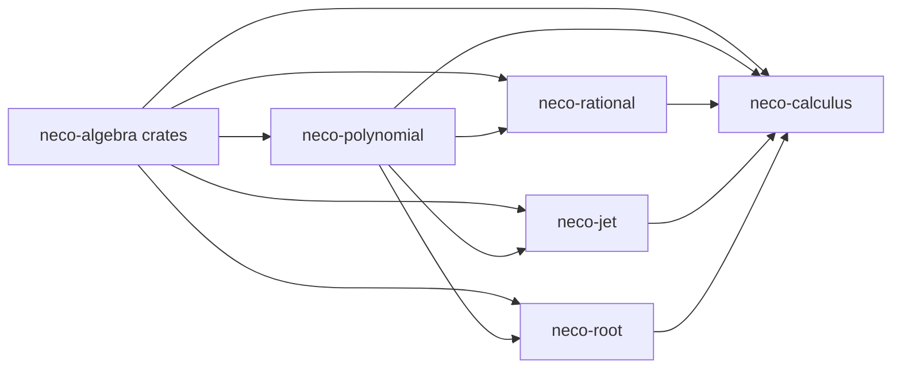

# neco-calculus

[日本語](README-ja.md)

`neco-calculus` is a suite of Rust crates for exact polynomial calculus over real algebraic numbers. Separate crates provide canonical polynomials, rational functions, finite derivative sequences, and root verification, and the `neco-calculus` crate exposes evaluation, derivative sequence, root bracket narrowing, interval sign classification, candidate root classification, and quadrature operations that combine them.

Root bracket narrowing shrinks an interval that contains a root by bisection or Newton-bisection and returns a narrowing witness of the process. Interval sign classification determines whether the sign of a polynomial is constant on an interval or changes within it. Candidate root classification takes the candidate points supplied by the caller, keeps those that are roots of the polynomial, and separates roots where the sign changes from roots where it stays the same.

Results of transcendental evaluation, checked surface evaluation (`evaluate_surface_checked`), and quadrature retain their provenance. The provenance consists of the owner identifier, the evaluation requirement, and the implementation identity (version and public API identifier).

The evaluation requirement contains the consumer identifier (the place that receives the result), the expression identifiers, the decision request, and the requested precision. The decision request specifies which exact decision (zero, equality, sign, or degeneracy) the consumer requests on which of the listed expressions (two expressions for equality).

The resources each operation uses have limits.

## Crates

* [`neco-polynomial`](https://crates.io/crates/neco-polynomial): Canonical exact polynomials, formal derivatives, and interval evaluation.
* [`neco-rational`](https://crates.io/crates/neco-rational): Exact rational functions with validated point and interval domains.
* [`neco-jet`](https://crates.io/crates/neco-jet): Finite sequences of exact derivative values with a public order limit.
* [`neco-root`](https://crates.io/crates/neco-root): Verified root brackets, root bracket narrowing with narrowing witnesses, multiplicity, interval sign classification, and candidate root classification.
* [`neco-calculus`](https://crates.io/crates/neco-calculus): Public operations for evaluation, derivative sequences, root bracket narrowing, interval sign classification, candidate root classification, and quadrature.

## Dependencies



**External Dependencies**

* [`neco-algnum`](https://docs.rs/neco-algnum): Exact real algebraic numbers and interval arithmetic.
* [`neco-bigint`](https://docs.rs/neco-bigint): Exact integer and dyadic arithmetic.
* [`neco-expr`](https://docs.rs/neco-expr): Identifiers recorded in result provenance, such as expression identifiers that name nodes of an expression graph.
* [`neco-formsum`](https://docs.rs/neco-formsum) and [`neco-monomial`](https://docs.rs/neco-monomial): Formal sums and monomials used to convert dyadic points to real algebraic numbers.

**Repositories Using This Repository**

* [`neco-geometry`](https://github.com/barineco/neco-geometry): Exact geometric computation with real algebraic coordinates.

## Related Links

* [Polynomial API Documentation](https://docs.rs/neco-polynomial)
* [Rational API Documentation](https://docs.rs/neco-rational)
* [Jet API Documentation](https://docs.rs/neco-jet)
* [Root API Documentation](https://docs.rs/neco-root)
* [Calculus API Documentation](https://docs.rs/neco-calculus)
* [Source Repository](https://github.com/barineco/neco-calculus)

## Runtime Configuration

In the default configuration, every crate in the dependency graph uses the standard library.

```toml
[dependencies]
neco-calculus = "0.2"
```

Disabling the default `std` feature leaves dynamic memory allocation as the only runtime requirement, so the crates can be used in environments without the standard library. Public values, results, and failure meanings are the same in both configurations.

```toml
[dependencies]
neco-calculus = { version = "0.2", default-features = false }
```

Every crate forbids `unsafe` code.

## License

MIT License. See [LICENSE](LICENSE) for details.
