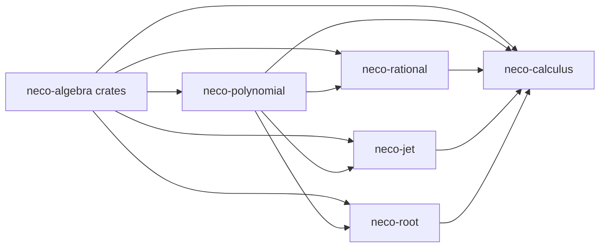

# neco-calculus

[日本語](README-ja.md)

`neco-calculus` is a suite of Rust crates for exact polynomial calculus over real algebraic numbers. It provides canonical polynomials, rational functions, finite derivative sequences, verified root analysis, and a calculus facade with typed provenance and finite resource limits.

## Crates

This repository consists of five crates:

* [`neco-polynomial`](https://crates.io/crates/neco-polynomial): Canonical exact polynomials, formal derivatives, and interval evaluation.
* [`neco-rational`](https://crates.io/crates/neco-rational): Exact rational functions with validated point and interval domains.
* [`neco-jet`](https://crates.io/crates/neco-jet): Finite sequences of exact derivatives with a public order limit.
* [`neco-root`](https://crates.io/crates/neco-root): Verified root brackets, refinement evidence, multiplicity, and local membership analysis.
* [`neco-calculus`](https://crates.io/crates/neco-calculus): Exact evaluation and refinement operations with observable provenance.

## Dependencies



**External Dependencies**

* [`neco-algnum`](https://docs.rs/neco-algnum): Exact real algebraic numbers and interval arithmetic.
* [`neco-bigint`](https://docs.rs/neco-bigint): Exact integer and dyadic arithmetic.
* [`neco-expr`](https://docs.rs/neco-expr): Stable expression identities used by validated evaluations.
* [`neco-formsum`](https://docs.rs/neco-formsum) and [`neco-monomial`](https://docs.rs/neco-monomial): Algebraic forms used by root evidence.

**Repositories Using This Repository**

* [`neco-geometry`](https://github.com/barineco/neco-geometry): Exact algebraic geometry computation.

## Related Links

* [Polynomial API Documentation](https://docs.rs/neco-polynomial)
* [Rational API Documentation](https://docs.rs/neco-rational)
* [Jet API Documentation](https://docs.rs/neco-jet)
* [Root API Documentation](https://docs.rs/neco-root)
* [Calculus API Documentation](https://docs.rs/neco-calculus)
* [Source Repository](https://github.com/barineco/neco-calculus)

## Runtime Configuration

The default configuration integrates with the standard library across the dependency graph.

```toml
[dependencies]
neco-calculus = "0.1"
```

Environments without the standard library use dynamic allocation alone. Public values, results, and failure meanings stay the same.

```toml
[dependencies]
neco-calculus = { version = "0.1", default-features = false }
```

Every crate forbids unsafe code.

## License

MIT License (See [LICENSE](LICENSE) for details).
